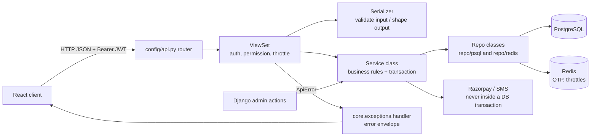
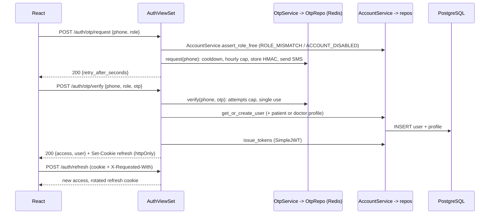
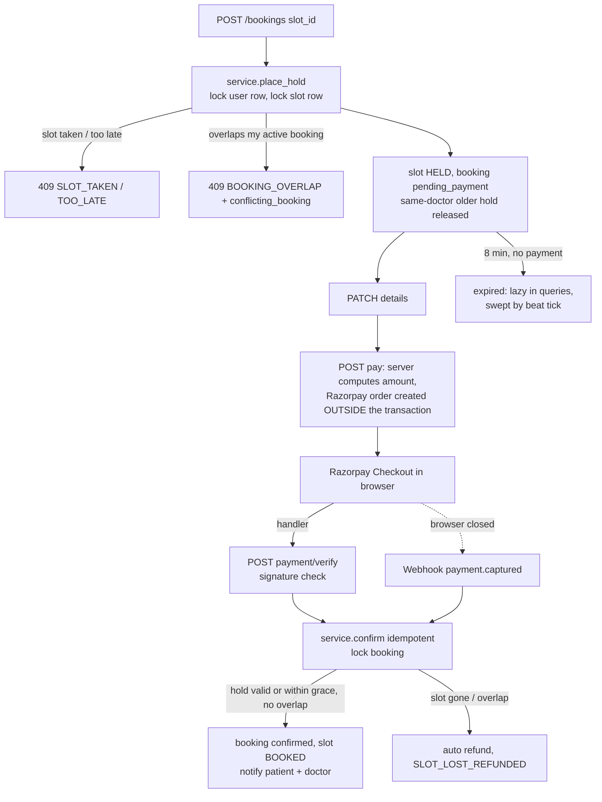
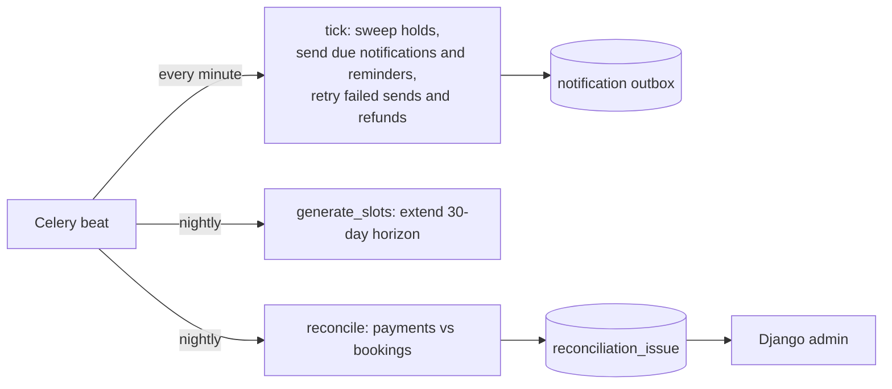
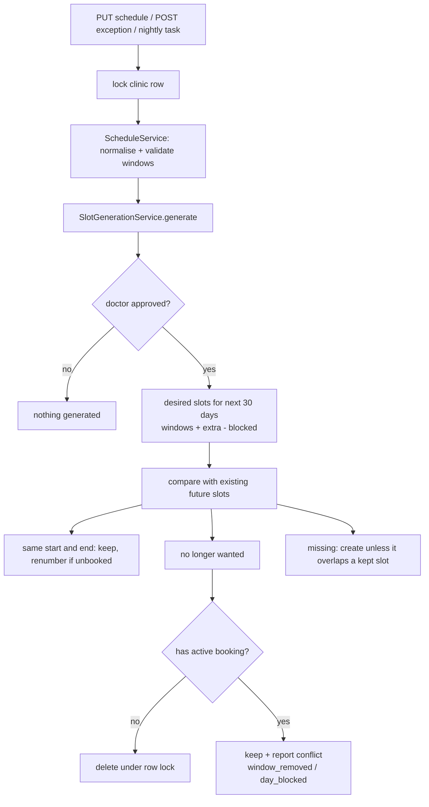

# Flow

Legend: **built** = in code now, **planned** = designed, not yet written.

## 1. Request path through the layers (built, shape fixed)

## 2. OTP login (built)

## 3. Booking: hold -> pay -> confirm (built; gateway is a stub)

## 4. Background work (nightly slots built, `tick` sweeps holds; reminders/reconcile planned)

## 5. Schedule change -> slots (built)

